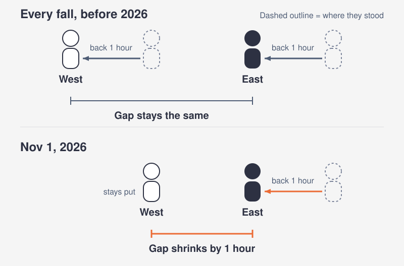
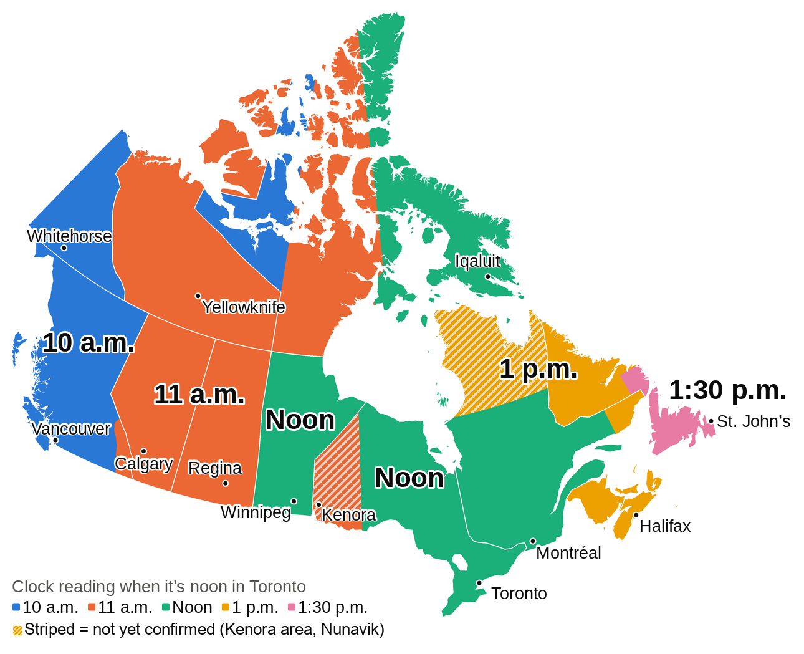
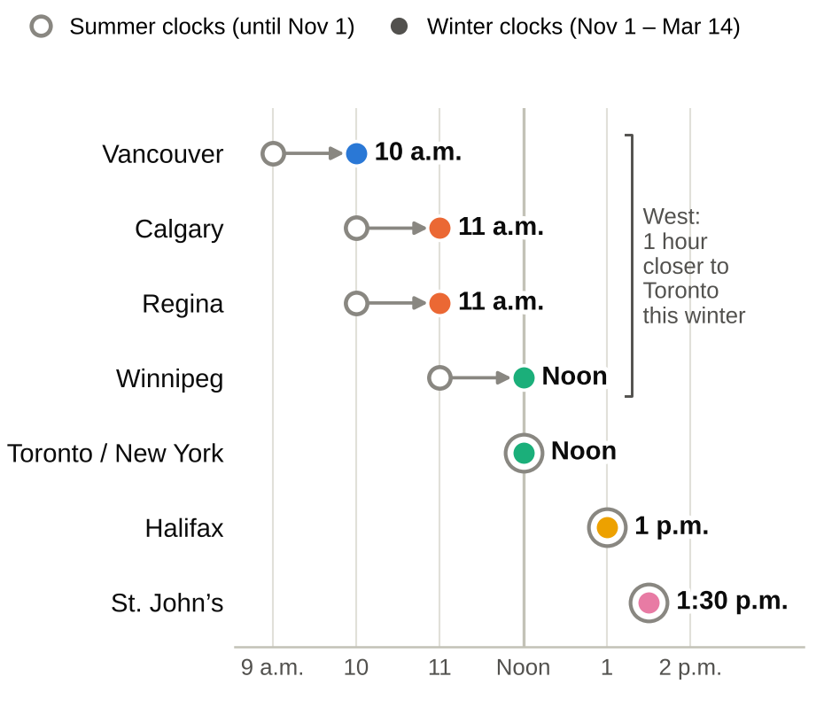
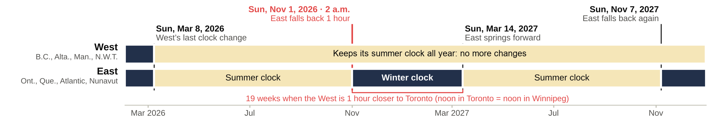
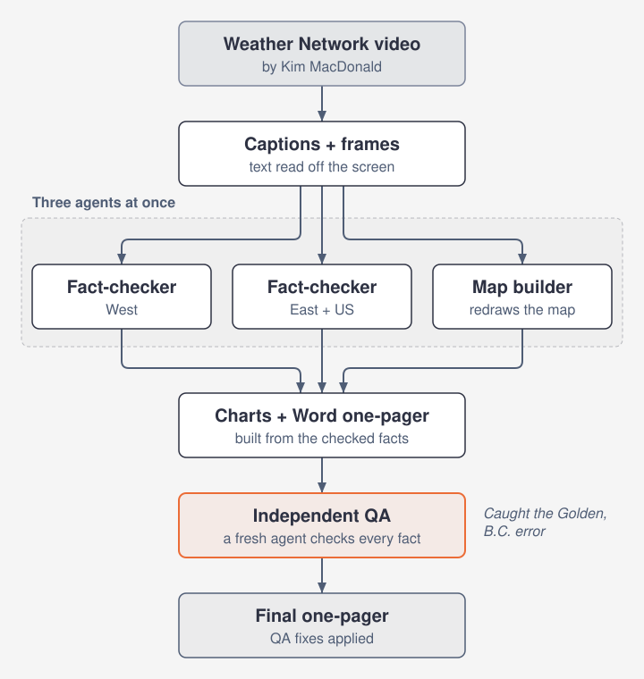

# What time is it in Canada? The 2026 clock change, explained like you're 5

**The short answer:** on Sunday, Nov 1, 2026, at 2 a.m. local time, the East falls back one hour and the West stays put.

*Prepared Oct 13, 2026.*

Two quick terms. To **fall back** is to set the clock one hour earlier in the autumn. To **spring forward** is to set it one hour ahead in the spring.

## Explain it like I'm 5

Picture a race. The runners from the East are in front. The runners from the West are a little way behind.

Every fall, the whole line used to take one big step back at the same moment. Everyone moved together, so the space between the East and the West stayed exactly the same.

This year the West sat out the step. Only the East steps back. That makes the space between them one hour smaller, and it stays smaller all winter.

Why did the West stop? B.C., Alberta, Manitoba and the Northwest Territories (N.W.T.) moved their clocks ahead on March 8, 2026, and they are keeping them there. Saskatchewan and Yukon quit the twice-a-year switch years ago, so these four have now joined them.

## Who moves their clocks on Nov 1?

| Stays put | Falls back one hour |
|---|---|
| Yukon | Ontario |
| B.C. | Quebec |
| Alberta | New Brunswick |
| Saskatchewan | Nova Scotia |
| N.W.T. (Northwest Territories) | Prince Edward Island |
| Manitoba | Newfoundland and Labrador |
| | Nunavut |

**Not yet confirmed:** Nunavik (far north Quebec) and the Kenora area (northwestern Ontario). See the fine print below.

Quebec is more than one clock: its Lower North Shore keeps Atlantic time all year.

## What the clocks say across Canada

This map answers one question: when it is noon in Toronto, what does the clock read in each part of the country? It covers this winter, Nov 1, 2026 to Mar 14, 2027. Each color is one clock reading.

Striped areas: not yet confirmed (the Kenora area and Nunavik).

## Same moment, two seasons

Pick one moment: noon in Toronto and New York. This chart shows what clocks read in other cities at that same moment. Hollow circles are summer clocks (until Nov 1). Filled dots are winter clocks (Nov 1 to Mar 14).

Why do the gaps shrink? The East changed its clocks and the West did not.

## When does it happen?

- **Sun, Mar 8, 2026:** the West's last clock change.
- **Sun, Nov 1, 2026, at 2 a.m. local time:** the East falls back one hour.
- **Sun, Mar 14, 2027:** the East springs forward again, and the summer gaps return.

From Nov 1 to Mar 14 is 19 weeks. For that whole stretch, the West sits one hour nearer to Toronto's clock.

## Fine print and fun twists

- **Kenora and northwestern Ontario are not settled.** Ontario has announced no change. Still, the shared database of time zone rules that phones rely on (release tzdata 2026e, Sep 29, 2026) treats the area as following Winnipeg.
- **Quebec is more than one clock.** Its Lower North Shore keeps Atlantic time all year, the same clock the Maritimes use this winter. Nunavik (far north Quebec) might keep daylight time (the summer clock), but that plan has not been confirmed.
- **Vancouver to Seattle:** Washington State still turns its clocks back, so Seattle runs an hour behind Vancouver this winter. Drive south and you gain an hour.
- **Alberta and Saskatchewan now share one clock all year.** Only the names differ: Alberta Time in one, Central Standard Time (CST) in the other.
- **B.C. has its own exceptions.** The East Kootenay and the town of Golden follow Alberta's clock, which runs one hour ahead of Vancouver's all year long. Golden's council reversed an earlier plan to fall back, on Sep 22, 2026.
- **Check your phone.** Phones get time zone rules from that shared database, and Manitoba's change only reached it on Sep 29, 2026 (release tzdata 2026e). An out-of-date device may show the wrong Winnipeg time after Nov 1, so keep it updated.
- **Spring 2027:** the East springs forward again on Mar 14, 2027, and the summer gaps come back. The West never touches its clocks.

## How this was made

This explainer began as a short Weather Network video by Kim MacDonald. A first Claude session turned it into a fact-checked one-page Word document, using AI helpers called agents (an agent is an AI helper that gets one job and a short brief). A second pass, run while writing this article, re-checked every claim. This is the flow of the first session.

Lessons from building it:

- **Run independent jobs side by side.** Two fact-checkers (one for the West, one for the East plus the US) and a map builder worked at the same time. The charts and the Word one-pager were built from their results, and then a fresh QA agent (QA means quality check) went over every fact. The session could not transcribe the audio, so it worked from the video's on-screen captions and sampled frames.
- **When checks disagree, run a narrow tiebreak.** In the first session, a fact-checker reported that Golden, B.C. would fall back one last time, and the QA agent caught that the town council had reversed that plan. In the second pass, a new fact-checker repeated the old Golden claim, so a narrow tiebreak against the newest dated sources settled it: the reversal (Sep 22, 2026) stands. The same pass downgraded two claims the first one-pager had stated as fact, Kenora and Nunavik, so this page labels them not yet confirmed. The lesson: tiebreak on the newest primary source (the official document or announcement itself, not a story about it), and label anything still open.
- **Say what you could not confirm.** One first-time-ever claim from the video could not be verified, so it is not here. At the QA pass, Manitoba's Sep 17 announcement was backed by news coverage rather than the law itself, and Nunavut was assumed to fall back as usual because no change had been announced.
- **Cap the searches.** Together, the four agents used about 570k tokens (a token is a small chunk of text that an AI model reads or writes, and usage is counted in them). The two fact-checkers made 23 and 42 web searches, far above the planned 10 or so, so a hard cap on searches is the main saving for next time.

The numbers in this section are the build session's own report, not an outside measurement.

## Sources

- Government of B.C., news release dated Mar 2, 2026
- Alberta Bill 31 (creates the Official Time Act)
- Government of N.W.T. (Apr 20, 2026)
- CP24 (Sep 23, 2026: N.W.T., Golden)
- Manitoba's announcement of Sep 17, 2026, as reported by The Weather Network
- Yukon.ca
- Saskatchewan.ca
- CBC/Eye on the Arctic (Nunavik)
- IANA tz mailing list
- IANA tzdata 2026e release notes (Sep 29, 2026)
- CTV News (Sep 22, 2026: Golden council reversal)
- Wikipedia, *Time in Canada*

Built from the Weather Network video *What time is it in Canada?* by Kim MacDonald. Map redrawn; zone boundaries simplified.

This is an explainer, not official guidance. Rules can change, so check your provincial or territorial government before you rely on it.
